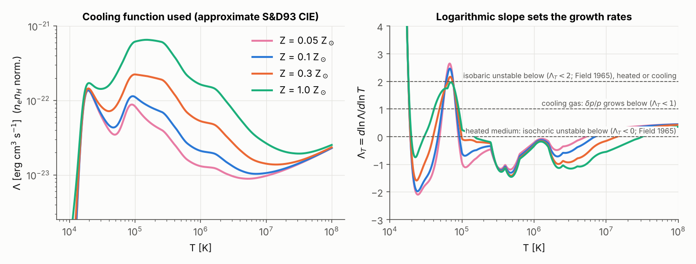
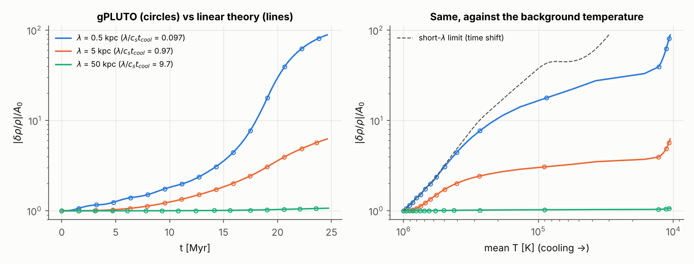
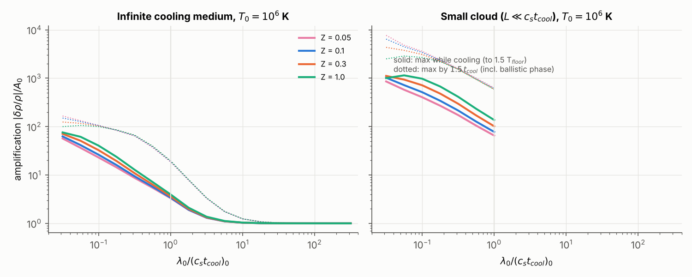
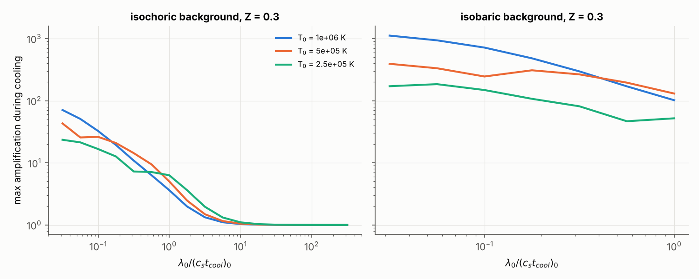
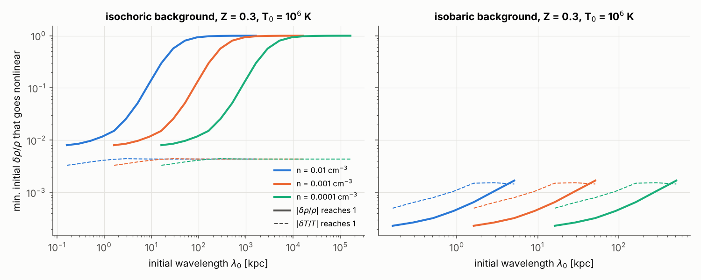
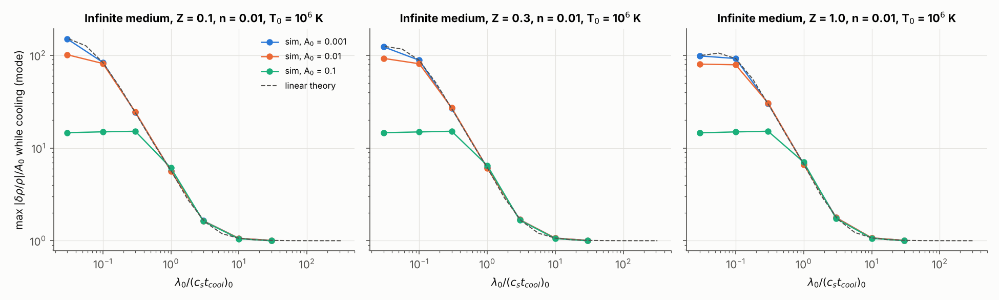
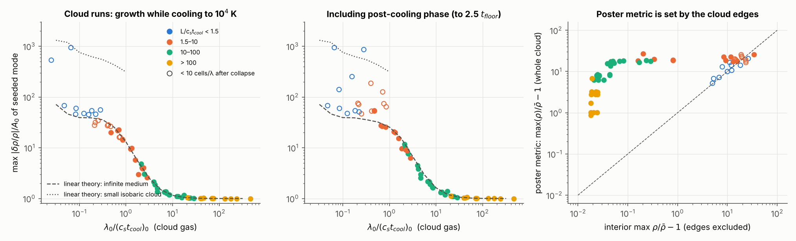
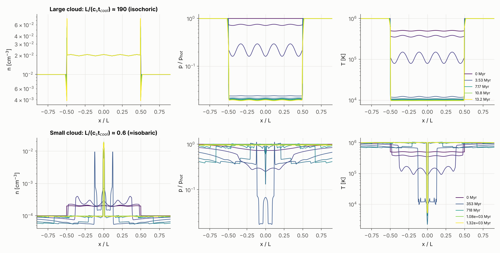
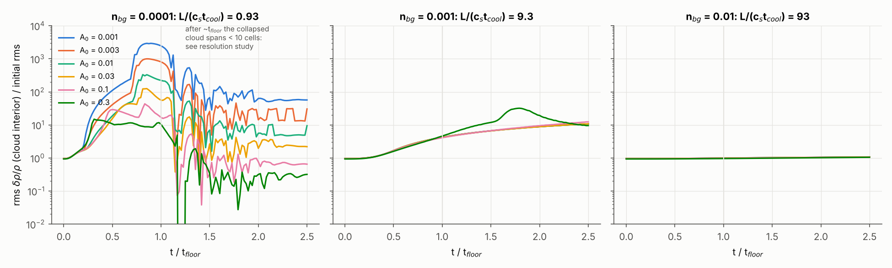
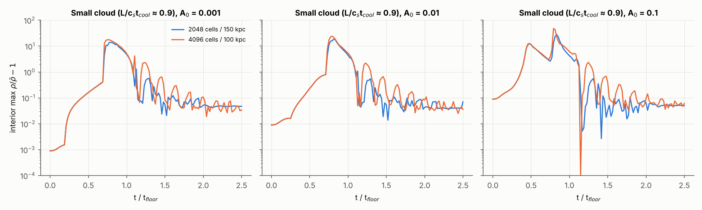

# Perturbation growth in cooling gas: results of the 1D survey

The question is how a small density perturbation grows inside gas that is cooling
(no heating in the cloud). Two configurations are covered: a finite cloud in a
hot background, as on the poster, and an infinite uniform cooling medium. The
comparison throughout is Das, Choudhury & Sharma (2021), where heating balances
cooling on average.

Everything here was produced with gPLUTO (1D, HLLC, PLM, RK2, tabulated cooling)
and an independent linear-theory integrator. About 170 runs went into the figures
below. The repository README (`astromcquinn/1DHydrodynamics`, branch
`claude/modest-knuth-40c0vv`) explains how to reproduce them.

## 1. Short version

1. **Linear theory on a cooling background.** For an isobaric (short-wavelength)
   mode, the instantaneous growth rate of δρ/ρ is the same as in Das et al.,
   (2 − Λ_T)/(γ t_cool). The difference is that the background evolves on that
   same timescale, so the growth is not exponential. A short-wavelength
   perturbation is just a *time shift* of the cooling history: the denser
   parcel reaches each temperature a little earlier. Its amplitude is

   - δρ/ρ ∝ t_cool,P(T₀)/t_cool,P(T) = (T₀/T)² Λ(T)/Λ(T₀) in a small cloud held at
     constant pressure, and
   - δρ/ρ ∝ [(T₀/T)² Λ(T)/Λ(T₀)]^{1/γ} in an infinite medium, which cools
     isochorically.

   So the total amplification is **finite and set by the cooling curve**, not by
   how long you wait.
2. **One parameter controls the growth: x = λ/(c_s t_cool)**, evaluated for the
   initial cloud gas. While the gas cools to 10⁴ K, the amplification is

   | x = λ/(c_s t_cool) | ≲ 0.1 | 0.3 | 1 | 3 | ≳ 10 |
   |---|---|---|---|---|---|
   | infinite medium (T₀ = 10⁶ K) | 80–150 | ~25 | ~6 | ~1.7 | ~1 (no growth) |

   Once the wavelength is expressed in units of c_s t_cool, **metallicity hardly
   matters** (Figs. 3 and 5). Z changes c_s t_cool, not the curve.
3. **Finite clouds behave like the infinite medium when L ≳ 1.5 c_s t_cool.**
   All 52 cloud runs in that range fall on or close to the infinite-medium
   linear-theory curve (Fig. 6). Only clouds smaller than about c_s t_cool get the extra
   isobaric (compression) amplification, up to ~10³ from 10⁶ K.
4. **Density is not an independent parameter.** For CIE cooling without heating,
   the equations are unchanged under n → a n with lengths and times scaled by 1/a.
   A scan to n = 10⁻⁴ cm⁻³ is the same as scanning cloud size and wavelength
   ×100. I checked this directly: runs with (n, L) = (10⁻², 50 kpc), (10⁻³, 500
   kpc) and (10⁻⁴, 5000 kpc) agree to 3–4 digits in scaled time.
5. **Minimum perturbation that goes nonlinear** (Fig. 4): about 1% for
   x ≲ 0.3 in an infinite medium or large cloud, rising to ≳ 30% for x ≳ 3; and
   2×10⁻⁴ to 2×10⁻³ in a small (isobaric) cloud. Nonlinear runs condense into cold
   clumps 30–45× denser than the mean.
6. **After the gas reaches the floor, growth continues ballistically.** The
   pressure differences during cooling leave a converging velocity field, so
   δρ/ρ keeps rising roughly linearly in time (×2–3 more by 2.5 t_floor for
   x ~ 1–10). In small clouds, by contrast, most of the structure is transient:
   once all the gas sits at 10⁴ K at the same pressure, the density evens out
   again.
7. **The poster's diagnostic, max(ρ)/ρ̄ − 1 over the whole cloud, measures the
   cloud edges, not the perturbation.** The edges are compressed when the cloud
   loses pressure support. In our runs that metric is typically 3–25 (median 15)
   even when the interior mode has not grown at all (Fig. 6, right).

## 2. Setup used here

* **Cloud.** Tophat of length L and density χ n_bg, with T = T_bg/χ (pressure
  equilibrium), T_bg = 10⁶ K. Inside it, δρ/ρ = A cos(2πx/λ) at uniform pressure
  (an isobaric seed). **Cooling is multiplied by a passive tracer**, so only
  cloud gas cools, matching the student's setup.
* **Infinite medium.** Periodic box of one wavelength filled with cloud gas.
  Pure cooling.
* **Cooling.** Λ(T, Z) = primordial CIE (Katz et al. 1996 rates) + Z × an
  approximation to the S&D93 solar metal curve (Fig. 1); the floor is 10⁴ K.
  See the caveat in the README.
* **Mode diagnostic.** Least-squares projection of ρ(m) onto cos/sin(k_m m) in the
  **Lagrangian (mass) coordinate**, using only the inner 60% of the cloud mass so
  the edges are excluded. Times are normalized by t_floor, the time for the
  unperturbed cloud gas to cool isochorically to the floor.

| quantity | value at n = 10⁻² cm⁻³, T = 10⁶ K | scaling |
|---|---|---|
| t_cool (isochoric) | 34 Myr (Z = 0.3) | ∝ 1/n |
| c_s t_cool | 13 / 5 / 1.7 kpc for Z = 0.1 / 0.3 / 1 | ∝ 1/n |
| same, cloud gas at χ = 2 (T = 5×10⁵ K) | 1.4 / 0.5 / 0.17 kpc | ∝ 1/n |

## 3. Results

### 3.1 Validation (Fig. 2)

Periodic runs with A = 10⁻⁴ and λ/(c_s t_cool) = 0.1, 1 and 10 match the linear
theory to 3–4 significant figures at every output, through the whole cooling
history. The short-wavelength run follows the time-shift formula until the
mode stops being isobaric near the hydrogen peak, where c_s t_cool collapses.

### 3.2 Linear amplification (Figs. 3 and 4)

The dashed grey line shows how much a mode would grow in the *heated* medium
of Das et al. over the same elapsed time. That's only ×1.3 (isochoric) to
×2.8 (isobaric), because there
t_cool stays fixed, while in cooling gas it shrinks by orders of magnitude as
the gas cools. At short wavelengths, lower starting temperatures give less total
amplification (Fig. 3b), because less of the cooling curve is left to
traverse.

### 3.3 Infinite-medium simulations (Fig. 5)

63 runs (Z = 0.1, 0.3, 1; x = 0.03–30; A = 10⁻³, 10⁻², 10⁻¹) agree with the linear
theory for A ≤ 10⁻². For A = 0.1 the amplitude saturates near 15× (i.e.
δρ/ρ ≈ 1.5), and the gas condenses into clumps with ρ/ρ̄ up to 30–45.

### 3.4 Cloud simulations (Figs. 6 and 7)

62 runs: Z = 0.1, 0.3, 1; n_bg = 10⁻⁴, 10⁻³, 10⁻²; L = 30 and 100 kpc; 2.5, 4.5
and 8.5 wavelengths per cloud; χ = 2, plus χ = 1.3 and 5 at the poster's
fiducial values. Together they span L/(c_s t_cool) from 0.2 to 2000.

Open symbols are runs where the cloud collapsed so much that the wavelength is
resolved by fewer than 10 cells. Their late-time values are not reliable (§3.6).

The top row shows a poster-like case, n_bg = 10⁻², L = 100 kpc, with
L/(c_s t_cool) ≈ 190. The cloud cools at constant density, its pressure drops
×50, and the seeded mode does not grow. The density spikes are all at the edges.
The bottom row shows a cloud with L ≈ 0.6 c_s t_cool: it is compressed as it
cools, the perturbation becomes nonlinear while it passes through ~10⁵ K, and
the cold gas collapses to a thin slab.

### 3.5 Initial-amplitude scan (Fig. 8)

L = 50 kpc, Z = 0.3, χ = 2. At n_bg = 10⁻² (L/c_s t_cool ≈ 90) nothing grows for
any A up to 0.3. At 10⁻³ (≈ 9) every amplitude grows the same way (×11 by
2.5 t_floor), linear until A ≈ 0.1. At 10⁻⁴ (≈ 0.9) the growth is ~10³ before the
floor and goes nonlinear even for A = 10⁻³.

### 3.6 Resolution (Fig. 10)

The small-cloud case (n_bg = 10⁻⁴, L = 50 kpc, L/(c_s t_cool) ≈ 0.9) is the most
demanding, because the cloud is compressed ~200–350× in density. Going from
2048 cells over 150 kpc to 4096 cells over 100 kpc (3× finer):

| A₀ | growth while cooling | peak interior max ρ/ρ̄ − 1 | at 1.5 t_floor |
|---|---|---|---|
| 10⁻³ | 1040 → 1120 | 14 → 17 | 0.05 → 0.08 |
| 10⁻² | 84 → 85 | 16 → 24 | 0.05 → 0.14 |

The linear growth and the late-time evening-out of the density are robust. The
peak nonlinear contrast and the final compression of the slab are not
converged. Runs at 16384 cells were still running when this was written.

## 4. Critique of the poster setup

These are meant as concrete suggestions for the student; several of them change
how the existing results should be read.

1. **The poster's clouds sit deep in the isochoric regime, where linear theory
   predicts no density growth.** At n_bg = 0.01–0.02 and T ≈ 10⁶ K, c_s t_cool of
   the cloud gas is ~0.2–6 kpc, but L = 30–200 kpc and λ ≈ 7–30 kpc. So x ≫ 1
   and the seeded mode should barely change while the cloud cools, which is what
   we find (Fig. 6, yellow and green points). The growth on the poster has to
   come from somewhere else; see the next point.
2. **The diagnostic.** max(ρ)/ρ̄ − 1 over the cloud is dominated by the
   compressed edges once the cloud loses pressure support. It also depends on
   how "the cloud" is defined as it shrinks, and on the mean density, which
   evolves. Measure the amplitude of the seeded mode instead: project onto the
   mode in mass coordinate, over the cloud interior. `plutorun.Run.analyse`
   does exactly this and can be reused.
3. **Comparing runs at a fixed simulation time.** t_cool differs by large factors
   between the Z, n and χ values on the poster, so at t = 0.1 the runs are at
   very different stages. Plot against the mean cloud temperature, or against
   t/t_cool. Then the metallicity "trend" on the poster (Fig. 7 there) largely
   disappears; metallicity mainly enters through c_s t_cool.
4. **Use dimensionless parameters.** The physics depends on λ/(c_s t_cool),
   L/(c_s t_cool), χ (equivalently the cloud temperature), Z (weakly) and A.
   Density and size are degenerate (exact scaling), so the planned scan to
   n = 10⁻⁴ costs nothing extra if it's framed as a scan in L/(c_s t_cool).
   The poster's explanations ("smaller clouds are more isobaric", "shorter
   wavelengths are more isobaric") are right in spirit; this makes them
   quantitative.
5. **Units and timescales.** The poster says 0.1 code units = 0.01 Gyr, but the
   profiles run to ~0.1 Gyr. With kpc and 100 km/s units, 1 code time unit is
   9.78 Myr. The runs also stop around 1 t_cool, before the post-cooling
   (ballistic) growth and the cloud's collapse play out.
6. **"Pressure equilibrium" holds only at t = 0.** Once the cloud cools, it is out
   of pressure balance with the hot gas, and for L ≫ c_s t_cool it stays out
   for a sound-crossing time of the cold gas. Edge effects then contaminate
   everything within ~c_s,hot t of the edges. The periodic "infinite cloud"
   removes the edges and is the cleanest place to measure growth.
7. **Background thermal model.** Masking cooling with a tracer, as the student
   did, works well, but the tracer diffuses at the edges, so mixed cells cool
   partially. A temperature cut (no cooling above, e.g., 0.6 T_bg, as in
   Gronke & Oh) avoids that. I also tried uniform heating equal to the
   background's cooling rate, with cooling everywhere. The hot gas pushed into
   the collapsing cloud then also cools, forms thin radiative shells, and the
   runs developed near-vacuum cells and stalled. With heating on, the hot medium
   at 10⁶ K is itself thermally unstable (Λ_T < 0), so it is not a clean
   background. I'd keep the mask.
8. **Resolution.** A cloud smaller than c_s t_cool is compressed by up to
   T_cloud/10⁴ K ≈ 50–100. The cells per wavelength must be counted *after* the
   collapse; 512 cells per cloud is not enough there. The cooling length at
   10⁴ K is unresolved in all runs, as usual.
9. **Single sinusoid and sharp tophat.** A single mode makes clean measurements
   but says little about fragmentation. Once the mode growth is understood, try
   a perturbation spectrum (random phases) and smoothed edges (`EDGE_WIDTH`).
10. **Cooling function at low density.** At n ~ 10⁻⁴ cm⁻³, photoionization by
    the UV background changes Λ substantially below ~10⁵ K. It also breaks the
    density scaling above, because ionization then depends on n. If the
    low-density regime matters, use Wiersma et al. (2009) tables, as Das et al.
    did.
11. **1D limits.** In 1D the cold gas can only form slabs, and at a uniform floor
    temperature and pressure the slabs end at the same density. "Shattering"
    needs 2D/3D. The 1D survey is still the right first step: it tells you
    which (x, L/c_s t_cool, A) to run in 2D.

## 5. Suggested next steps for the student

1. Reproduce Fig. 2 with her own PLUTO install. This validates her code, her
   cooling table and the diagnostic in a day. The PLUTO 4.4 port in
   `pluto_setup/pluto4.4_untested/` should be compiled and checked against the
   gPLUTO version first.
2. Swap in her S&D93 tables (`cooling.load_table`) and recompute the linear
   maps. That takes about 10 minutes and shows how much the conclusions depend on
   the detailed Λ_T.
3. Write the paper's central plot as amplification vs λ/(c_s t_cool) for
   several L/(c_s t_cool), with linear theory and simulations together (Fig. 6
   is a template). Then the minimum-amplitude map (Fig. 4).
4. Follow the nonlinear outcome (clump contrast, number of clumps, whether they
   merge) for x ≲ 1 and A ≳ 0.01, at higher resolution, then in 2D.

## 6. What was not done or is uncertain

* The cooling table is an approximation (§2); trends in x should be robust, but
  the precise amplification factors depend on Λ_T between 10⁵ and 10⁶ K.
* The PLUTO 4.4 files were not compiled.
* The heated-background comparison did not produce usable runs (§4, item 7).
* Late-time values for strongly compressed small clouds are resolution-limited.
