# Perturbation growth in cooling gas: results of the 1D survey

The question is how small perturbations grow inside gas that is cooling (no
heating in the cloud). Two configurations are covered: a finite cloud in a hot
background, as on the poster, and an infinite uniform cooling medium. The
comparison throughout is Das, Choudhury & Sharma (2021), where heating balances
cooling on average.

Everything here was produced with gPLUTO (1D, HLLC, PLM, RK2, tabulated
cooling) and an independent linear-theory integrator; about 420 simulations went
into the figures. The repository README (`astromcquinn/1DHydrodynamics`, branch
`claude/modest-knuth-40c0vv`) explains how to reproduce them.

**Revision note.** Earlier versions measured "growth while cooling" up to the
time the gas reached 1.05 × the floor (or equilibrium) temperature. Cooling just
above the floor is slow, so that time can be 1.2–3× longer than the actual
cooling and included post-cooling growth. All times are now normalized by
**t_cool = the time for the unperturbed cloud gas to cool to 1.5 × T_floor (or
1.5 × T_eq)**. This lowers the "while cooling" numbers by about 2× at short
wavelengths and removes the apparent difference between collisional cooling and
the UV background (§4.6). The list of corrections is at the end.

## 1. Short version

1. **Linear theory on a cooling background.** For a short-wavelength (isobaric)
   mode, the instantaneous growth rate of δρ/ρ is the same as in Das et al.,
   (2 − Λ_T)/(γ t_cool). The difference is that the background evolves on that
   same timescale, so growth is not exponential. A short-wavelength perturbation
   is a *time shift* of the cooling history (the denser parcel reaches each
   temperature a little earlier), with amplitude

   - δρ/ρ ∝ t_cool,P(T₀)/t_cool,P(T) = (T₀/T)² Λ(T)/Λ(T₀) in a small cloud held at
     constant pressure, and
   - δρ/ρ ∝ [(T₀/T)² Λ(T)/Λ(T₀)]^{1/γ} in an infinite medium, which cools
     isochorically.

   The total amplification is finite and set by the shape of the cooling curve.
2. **One parameter controls the growth: x = λ/(c_s t_cool)** of the initial
   cloud gas. For an infinite medium starting at 10⁶ K (Z = 0.3):

   | x = λ/(c_s t_cool) | 0.03 | 0.1 | 0.3 | 1 | 3 | 10 |
   |---|---|---|---|---|---|---|
   | growth while cooling | 71 | 33 | 11 | 3.6 | 1.3 | 1.03 |
   | growth by 3 t_cool | 124 | 103 | 66 | 24 | 4 | 1.3 |

   (linear theory; the simulations agree). Metallicity enters mostly through
   c_s t_cool: at fixed x, Z = 0.05 and Z = 1 differ by ≲ 30%.
3. **Finite clouds behave like the infinite medium when L ≳ 1.5 c_s t_cool**
   (Fig. 6). Only clouds smaller than about c_s t_cool get the extra isobaric
   (compression) amplification, up to ~10³.
4. **With collisional cooling, density is not an independent parameter.** The
   equations are unchanged under n → a n with lengths and times scaled by 1/a,
   so a density scan is a size scan. Runs with (n, L) = (10⁻², 50 kpc),
   (10⁻³, 500 kpc) and (10⁻⁴, 5000 kpc) agree to 3–4 digits. A photoionizing UV
   background breaks this scaling, but only weakly (§4.6).
5. **"Isochoric" does not mean "no growth".** For λ ≫ c_s t_cool the density is
   frozen while the gas cools, but temperature and pressure perturbations grow
   12–50×. Afterwards the resulting pressure pattern drives density growth
   G − 1 ≈ 25 (c_s t_cool/λ)² by 2.5 t_cool, over λ = 2–460 c_s t_cool, and
   still rising (§4.4).
6. **Minimum seed that goes nonlinear** (Fig. 4): about 1% for x ≲ 0.3 in an
   infinite medium or a large cloud, rising steeply for x ≳ 1; about 10⁻³ in a
   small (isobaric) cloud. Seeds of 0.1 at x ≲ 1 condense into clumps 30–45×
   denser than the mean.
7. **Perturbations grow while the gas cools, but often not for good.** After the
   gas reaches the floor or T_eq, short-wavelength structure becomes sound
   waves in the cold gas and small clouds smooth out again. What lasts is the
   slow post-cooling growth at x ≳ 1, and clumps from seeds that went
   nonlinear before the gas settled (§4.8).
8. **A photoionizing UV background changes the details, not the picture.**
   With Cloudy tables in the Haardt & Madau (2012) z = 0 background, linear
   growth is within ~20% of collisional cooling with the same atomic data, in
   infinite media and in clouds. The main difference is nonlinear: in
   intermediate clouds large seeds form dense clumps sooner and stronger
   (§4.6).
9. **Not just density.** Temperature, sound-wave, velocity and metallicity
   seeds were compared at the same amplitude (§4.7). What grows is the entropy
   (cooling-time) part of a perturbation. A temperature seed gives ~0.6× the
   growth of a density seed, with the opposite sign (hot spots end up
   underdense); a metallicity seed ~0.35× (metal-rich gas ends up denser).
   Sound waves and velocity seeds carry no entropy and grow 10–40× less at
   short wavelengths, but at long wavelengths a velocity seed compresses the
   gas directly and matters as much as a density seed.
10. **The student's interior/central maximum is a sound diagnostic.** A maximum
    over the whole cloud would be dominated by the compressed edges (3–25 in
    our runs even when nothing grows inside), which her central measurement
    avoids.

## 2. Setup and definitions

* **Cloud.** Tophat of length L and density χ n_bg, with T = T_bg/χ (pressure
  equilibrium), T_bg = 10⁶ K. Cooling is multiplied by a passive tracer, so
  only cloud gas cools, matching the student's setup.
* **Infinite medium.** Periodic box of one wavelength filled with cloud gas.
* **Cooling models.**
  - *Original*: Λ(T, Z) = primordial CIE (Katz et al. 1996 rates) + Z × an
    approximation to the S&D93 solar metal curve, with a 10⁴ K floor. Compared
    with Cloudy it is 0.1–0.3 dex too high between 2×10⁵ and 3×10⁶ K.
  - *CIE (Cloudy)*: Grackle's Cloudy collisional-equilibrium tables, same floor.
  - *UV background*: Grackle's Cloudy photoionization-equilibrium tables in the
    Haardt & Madau (2012) background at z = 0, with photoheating and no floor.
    The gas settles at T_eq = 1.9×10⁴, 1.3×10⁴ and 1.0×10⁴ K at
    n = ρ/m_p = 10⁻⁴, 10⁻³ and 10⁻² cm⁻³.
* **Seeds.** Unless stated otherwise, δρ/ρ = A cos(2πx/λ) at uniform pressure.
  §4.7 adds temperature, sound-wave, velocity and metallicity seeds.
* **Diagnostic.** Least-squares projection onto cos/sin(k_m m) in the
  **Lagrangian (mass) coordinate**, using the inner 60% of the cloud mass so
  the edges are excluded. The same projection gives δT/T, δp/p, the entropy
  δ ln K (K = p/ρ^γ), the velocity and the metallicity.
* **Time normalization.** t_cool is the time for the unperturbed cloud gas to
  cool isochorically to 1.5 × T_floor or 1.5 × T_eq. "While cooling" means
  t ≤ t_cool; "by 2.5 t_cool" includes the post-cooling phase.

| quantity | at n = 10⁻² cm⁻³, T = 10⁶ K, Z = 0.3 | scaling (collisional) |
|---|---|---|
| t_cool (isochoric, e-folding) | 34 Myr | ∝ 1/n |
| time to cool to 1.5×10⁴ K | 20 Myr | ∝ 1/n |
| c_s t_cool | 13 / 5 / 1.7 kpc for Z = 0.1 / 0.3 / 1 | ∝ 1/n |
| same, cloud gas at χ = 2 (5×10⁵ K) | 1.4 / 0.5 / 0.17 kpc | ∝ 1/n |

## 3. Linear theory on a cooling background

The linearized equations are integrated forward in time for one Fourier mode in
the Lagrangian mass coordinate m, on a uniform background that cools. With
δρ/ρ = s cos(k_m m), δp/p = q cos(k_m m), δv = w sin(k_m m), D = d ln ρ₀/dt and
net loss L(ρ, T) per unit volume:

  ds/dt = s D − k w,  dw/dt = k (p₀/ρ₀) q,
  dq/dt = q r + γ s D − γ k w − (γ−1)/p₀ [L_ρ s + L_T (q − s)] − (γ−1)/p₀ L_Z ζ,

where r = (γ−1)L/p₀, L_ρ = ∂L/∂ln ρ, L_T = ∂L/∂ln T, L_Z = ∂L/∂ln Z and ζ is a
metallicity perturbation (constant on each fluid element). The **infinite
medium** has D = 0; a **small cloud** at the fixed hot-gas pressure has
D = r/γ, so it compresses and k grows with ρ₀. For collisional cooling,
L_ρ = 2L and L_T = Λ_T L. In the steady heated case these equations reproduce
the Das et al. rates, (2 − Λ_T)/(γ t_cool) and −Λ_T/t_cool.

Two limits are useful:

* **Short wavelength**: ds/dt = (2 − Λ_T) r s/γ. Same instantaneous rate as
  Das, but integrated along a background that cools, which gives the time-shift
  formulas in §1.
* **Long wavelength**: s stays fixed while d(δp/p)/dt = (1 − Λ_T) r (δp/p) −
  (2 − Λ_T) r s. The pressure/temperature perturbation is driven by the frozen
  density perturbation, and in cooling gas it grows on its own wherever
  Λ_T < 1 (Das: Λ_T < 0).

## 4. Results

### 4.1 Validation (Figs. 2 and 13)

Periodic gPLUTO runs with A = 10⁻⁴ match the linear theory to 3–4 significant
figures through the whole cooling history, for λ/(c_s t_cool) = 0.1, 1 and 10,
with collisional cooling (Fig. 2) and with the UV background (Fig. 13). With the
2D (density, temperature) tables this required using the exact slopes of the
bilinear interpolation PLUTO uses. The five seed types of §4.7 match equally
well (Fig. 18).

### 4.2 Growth versus λ/(c_s t_cool) (Figs. 3–5)

In linear theory (Fig. 3), the amplification of an infinite medium starting at
10⁶ K (Z = 0.3) while it cools falls from ~70 at x = 0.03 to 3.6 at x = 1 and ~1
for x ≳ 10. Including the post-cooling phase to 3 t_cool it is ~120, 24 and 1.3.
In a small cloud held at constant pressure, the compression adds a large
factor: ~10³ while cooling at x ≲ 0.1, ~3–4×10³ by 3 t_cool. Starting cooler
leaves less of the cooling curve to traverse: from 2.5×10⁵ K the infinite-medium
amplification is ≲ 25 (Fig. 3b). In the heated medium of Das et al., a mode
would grow only 2.3× (isobaric) or 1.2× (isochoric) over the same elapsed time,
because there t_cool stays fixed, while in cooling gas it shrinks by orders of
magnitude.

Fig. 4 turns this into the smallest seed that reaches δρ/ρ ~ 1 by 3 t_cool. In an
infinite medium or a large cloud it is ~1% for x ≲ 0.3, 4% at x = 1 and 25% at
x ≈ 3; for x ≳ 10 no seed below order unity gets there. In a small isobaric
cloud it is 2×10⁻⁴ to 2×10⁻³.

The 63 infinite-medium simulations (Z = 0.1, 0.3, 1; x = 0.03–30;
A = 10⁻³–10⁻¹) follow the linear theory for A ≤ 10⁻². For A = 0.1 the growth
saturates near 15× (δρ/ρ ≈ 1.5) and the gas condenses into clumps with
ρ/ρ̄ = 30–45 for x ≲ 1.

### 4.3 Clouds (Figs. 6 and 7)

62 runs: Z = 0.1, 0.3, 1; n_bg = 10⁻⁴, 10⁻³, 10⁻²; L = 30 and 100 kpc; 2.5, 4.5
and 8.5 wavelengths per cloud; χ = 2, plus χ = 1.3 and 5 at the poster's
fiducial values. Together they span L/(c_s t_cool) from 0.2 to 2000. Clouds with
L ≳ 1.5 c_s t_cool lie on the infinite-medium curve. Smaller clouds lie between
the infinite-medium and small-cloud limits. Typical values for χ = 2:

| x = λ/(c_s t_cool) | ~0.2 | ~1 | ~2 | ~5 | ≥ 10 |
|---|---|---|---|---|---|
| growth while cooling | 18 | 4 | 1.9 | 1.2 | 1.0 |
| growth by 2.5 t_cool | 32 | 15 | 5.8 | 2.2 | 1.06 |

Open symbols are runs where the cloud collapsed so much that the wavelength is
resolved by fewer than 10 cells after the collapse (§4.5).

The top row of Fig. 7 is a poster-like large cloud (L ≈ 190 c_s t_cool): it
cools at constant density, its pressure drops ×50, and the seeded mode does not
grow while the edges are compressed. The bottom row is a cloud with
L ≈ 0.6 c_s t_cool: it is compressed as it cools, the perturbation goes
nonlinear while it passes through ~10⁵ K, and the cold gas collapses to a thin
slab.

### 4.4 The isochoric regime (Fig. 11)

For λ ≫ c_s t_cool each parcel cools at its own fixed density. The cooling rate
per particle is ∝ n Λ(T), so denser parcels run ahead in temperature: δT/T = δp/p
grows 12–50× during cooling (0.24–1.0 from δρ/ρ = 0.02), independent of λ. That
pressure pattern pushes gas from the hotter, underdense parcels into the colder
ones. Over the cooling time the gas moves only ~(c_s t_cool/λ)² of a wavelength,
but the velocity persists after cooling, so the density keeps growing roughly
linearly in time. All 37 cloud runs with λ = 2–460 c_s t_cool and
L ≥ 1.5 c_s t_cool follow

  **G − 1 ≈ 25 (c_s t_cool/λ)²** by 2.5 t_cool (10–90% range of the prefactor:
  21–29),

the scaling expected for a pressure impulse of order δT/T acting for ~t_cool
across a wavelength. The prefactor keeps growing with time. The convergence
completes on the sound-crossing time of λ in the cold gas, ≈ 7x t_cool for gas
starting at 5×10⁵ K, well beyond our runs and the poster's.

If the seed is large enough that δT/T reaches order unity during cooling,
parts of the cloud reach 10⁴ K while their neighbours are still hot and get
crushed: the isochoric fragmentation picture of McCourt et al. (2018).

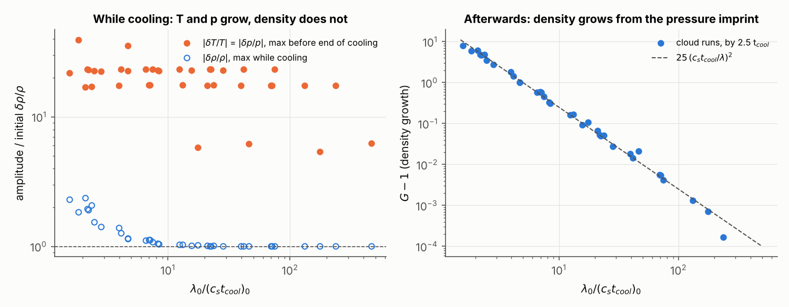

### 4.5 Seed amplitude and resolution (Figs. 8 and 10)

Cloud of L = 50 kpc, χ = 2, Z = 0.3, at three background densities:

* n_bg = 10⁻² (L ≈ 90 c_s t_cool): nothing grows for any A up to 0.3.
* n_bg = 10⁻³ (L ≈ 9 c_s t_cool): every seed grows the same way, ×2 while
  cooling and ×6.5 by 2.5 t_cool, linear until A ≈ 0.1. A = 0.3 goes nonlinear
  after ~2.5 t_cool (contrast ~60 by 3 t_cool).
* n_bg = 10⁻⁴ (L ≈ 0.9 c_s t_cool): ~50× growth while cooling and much more
  during the collapse that follows. Even A = 10⁻³ reaches an interior contrast of
  ~15, which then smooths out to ≲ 0.1 by the end of the run.

The small cloud is compressed 200–350× in density, so it is the hardest case to
resolve. Comparing 2048, 4096 and 16384 cells: the growth while cooling is
converged (52 / 52 / 51 for A = 10⁻³), the peak contrast is converged for small
seeds (14 / 18 / 19) but not for A = 0.1 (28 / 47 / 75, a lower limit), and the
late-time smoothing is seen at every resolution.

### 4.6 Photoionizing UV background (Figs. 12–17)

The UV background suppresses cooling below ~10⁵ K, strongly at low density (at
n = 10⁻⁴ the 10⁵ K peak is roughly halved and the hydrogen peak near 2×10⁴ K
disappears), and replaces the floor with a density-dependent T_eq (Fig. 12).
Because T_eq falls with density, compressed gas is cooler than its surroundings
at equilibrium, which makes it easier to compress than gas held at a floor.

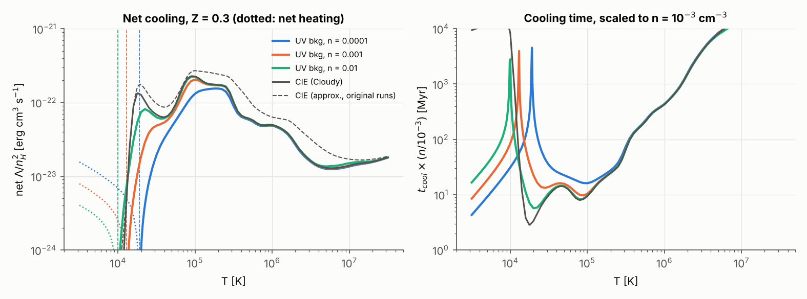

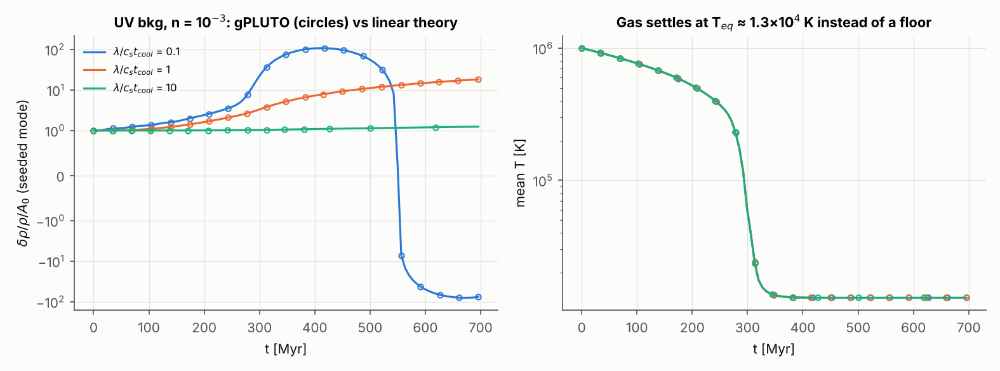

**Linear theory (Fig. 14).** For an infinite medium starting at 10⁶ K, the
amplification with the UV background is within ~25% of Cloudy CIE with a floor
at every density from 10⁻⁴ to 10⁻², both while cooling and by 3 t_cool. At
x ≈ 0.3, for example, it is 10–13 while cooling and 50–67 by 3 t_cool, against
10 and 59 for Cloudy CIE. For small isobaric clouds the totals by 3 t_cool also
agree to ~25% (1.4–1.8×10³ at x ≈ 0.3), although at n = 10⁻² more of the growth
happens before the gas reaches 1.5 T_eq. Starting from 5×10⁵ K gives the same
picture.

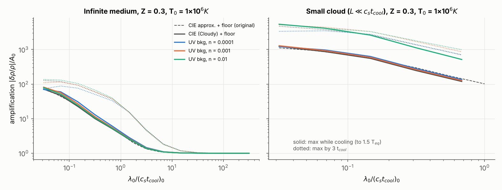

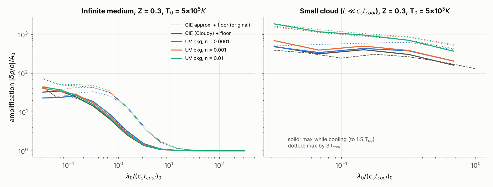

**Infinite medium (Fig. 15).** The simulations reproduce the linear theory for
every model, metallicity and density. Z = 0.3:

| x = λ/(c_s t_cool) | 0.03 | 0.1 | 0.3 | 1 | 3 |
|---|---|---|---|---|---|
| original CIE + floor | 57 / 123 | 27 / 103 | 10 / 68 | 3.4 / 20 | 1.3 / 3.6 |
| Cloudy CIE + floor | 63 / 125 | 30 / 108 | 9.7 / 60 | 3.6 / 21 | 1.4 / 4.1 |
| UV bkg, n = 10⁻⁴ | 66 / 72 | 41 / 86 | 13 / 52 | 4.1 / 21 | 1.5 / 4.3 |
| UV bkg, n = 10⁻³ | 75 / 109 | 37 / 107 | 11 / 62 | 3.8 / 21 | 1.4 / 4.1 |
| UV bkg, n = 10⁻² | 82 / 135 | 37 / 120 | 11 / 69 | 3.8 / 21 | 1.4 / 4.1 |

(growth while cooling / by 2.5 t_cool). The UV background changes the linear
growth by less than ~25% at x ≥ 0.1. Seeds of 0.1 again condense into clumps
26–46× denser than the mean.

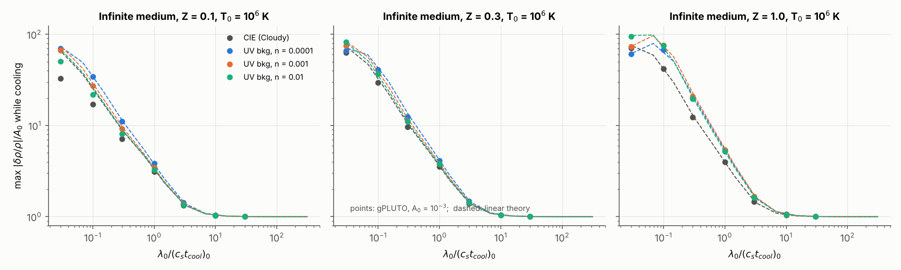

**Clouds (Fig. 16).** For the 39 cloud pairs resolved in both runs, the UV/CIE
ratio of the growth while cooling has median 1.06 (10–90%: 1.00–1.78), and of
the growth by 2.5 t_cool 1.32 (1.01–2.37). The isochoric scaling of §4.4 holds
with the same prefactor (median 24). The cooling length, and hence x and
L/(c_s t_cool) for a given cloud, now depend on density in a way they did not
with collisional cooling.

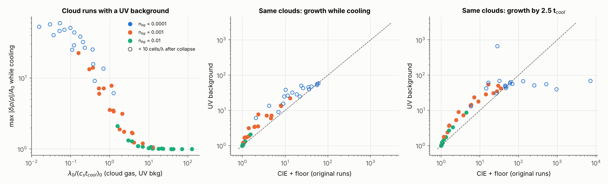

**Nonlinear seeds (Fig. 17), compared over the same 3 t_cool.** In the
intermediate cloud (n_bg = 10⁻³, L ≈ 5–9 c_s t_cool), the UV background makes
large seeds go nonlinear sooner: A = 0.3 reaches an interior contrast of ~100 by
1.4 t_cool (CIE + floor: ~10 at 2.5 t_cool, ~60 at 3 t_cool), and A = 0.1
reaches ~8 (CIE + floor: ~1). In the small cloud the transient structure
smooths out more completely (contrast ~10⁻³ by 3 t_cool, against ~0.05).

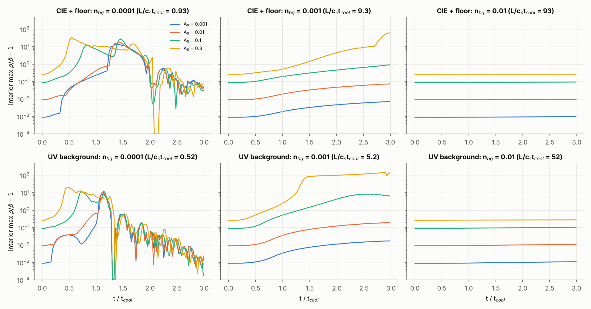

### 4.7 Different kinds of perturbation (Figs. 18–21)

Five seeds with the same amplitude A and wavelength, in the cloud gas:

| seed | initial state | entropy δ ln K |
|---|---|---|
| density | δρ/ρ = A, δp = 0 (cooler) | −γA |
| temperature | δT/T = δp/p = A, δρ = 0 (hot spot) | +A |
| sound wave | δρ/ρ = A, δp/p = γA, standing | 0 |
| velocity | δv = A c_s sin(kx) | 0 |
| metallicity | δZ/Z = A at uniform ρ, p | 0 (but faster cooling) |

Metallicity is carried as a second passive tracer, and the cooling uses the
Cloudy primordial and metal rates combined with the local Z. These runs use the
Cloudy tables with and without the UV background; the two agree closely
(mostly within 5%; 25% for the velocity seed at x = 0.1).

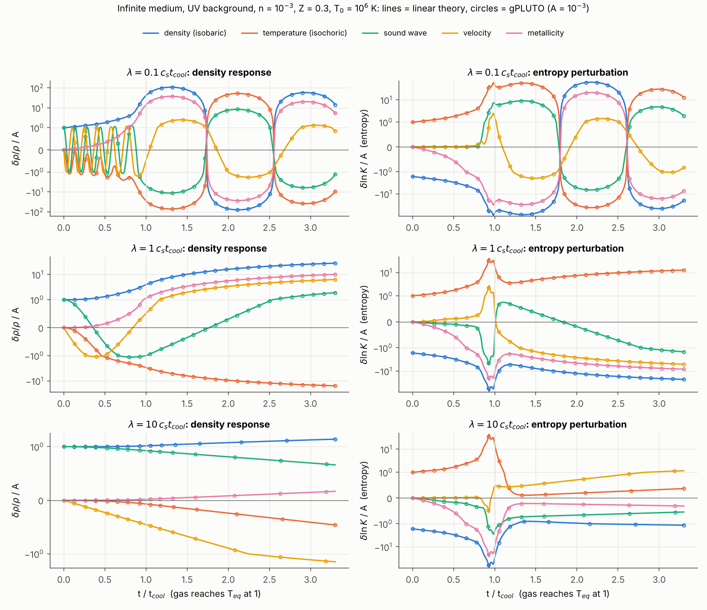

Infinite medium, n = 10⁻³, Z = 0.3, A = 10⁻³, UV background, |δρ/ρ|/A by
2.5 t_cool (sign of the late density perturbation relative to the seed):

| x = λ/(c_s t_cool) | density | temperature | metallicity | sound | velocity |
|---|---|---|---|---|---|
| 0.1 | 107 | 71 (−) | 38 | 11 | 2.5 |
| 1 | 21 | 12 (−) | 7.5 | 1.1 | 4.7 |
| 10 | 1.3 | 0.32 (−) | 0.11 | ~1 (oscillating) | 1.1 |

What grows is the entropy (cooling-time) perturbation:

* A **temperature** seed carries −1/γ times the entropy of a density seed and
  gives ~0.6× its growth, with the opposite sign: hot spots end up underdense.
* A **metallicity** seed changes the cooling rate (metals carry ~88% of the
  cooling at 10⁶ K for Z = 0.3) and gives ~0.35× the growth of a density seed.
  Metal-rich gas ends up denser. Because Z stays with the gas, the forcing
  never switches off.
* **Sound waves and velocity seeds** carry no entropy. Cooling converts some of
  their compression into entropy (Fig. 18, right), giving 10–40× less growth
  than a density seed at short wavelengths. At long wavelengths the velocity
  seed compresses the gas directly: at x = 10 it produces δρ/ρ ≈ 1.1 A, about
  as much as a density seed (1.3 A, which barely grows), while temperature and
  metallicity seeds give only 0.3 A and 0.1 A.

The linear-theory survey (Fig. 19) confirms this ordering across wavelengths.
By 3 t_cool, the amplification relative to A is:

| x = λ/(c_s t_cool) | density | temperature | metallicity | sound | velocity |
|---|---|---|---|---|---|
| ≈ 0.15 | 93 | 50 | 32 | 10 | 8.5–9 |
| ≈ 1.5 | 15 | 11 | 5.3 | 3.8 | 1.5 |
| ≈ 15 | 1.2 | 0.19 | 0.07 | 1.0 | 0.9 |

The values with and without the UV background agree to within ~5%.

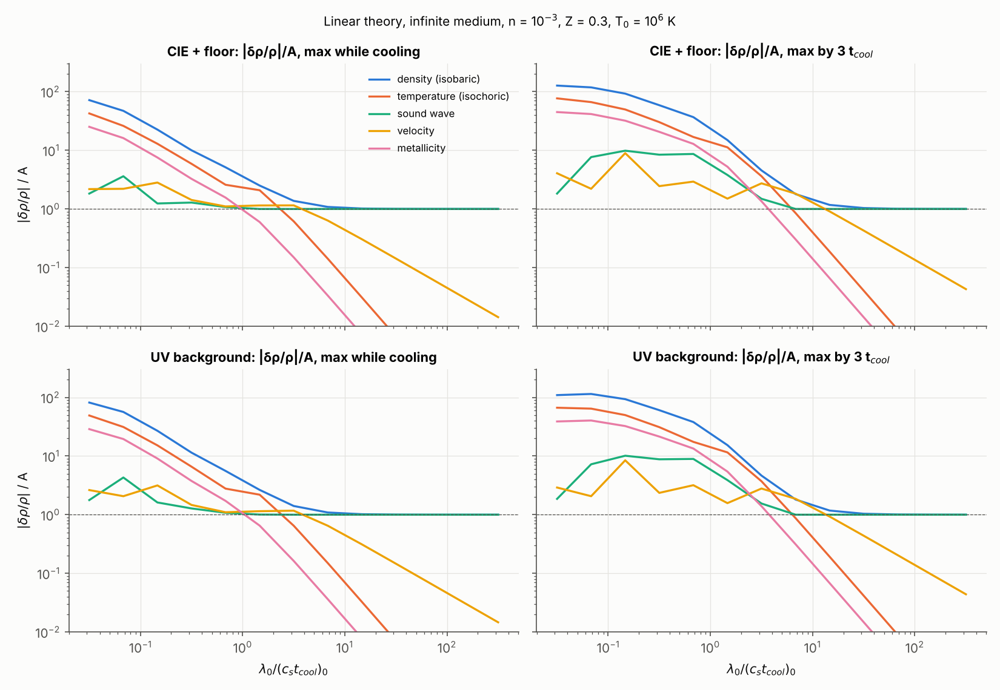

In clouds (n_bg = 10⁻³, x ≈ 1.2, A = 0.02), the ordering is the same: by
2.5 t_cool the density seed grows 15–16×, the temperature seed 11–12×, the
sound-wave and metallicity seeds ~4×, and the velocity seed ~3×. At
n_bg = 10⁻² (x ≈ 12) only the density seed grows (×1.17); the others produce
at most 0.8 A.

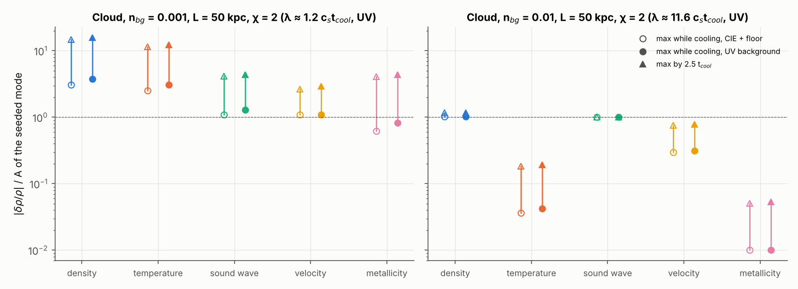

Nonlinear seeds (A = 0.1) follow the same ordering: at x = 0.1 density,
temperature and metallicity seeds condense into clumps 15–34× denser than the
mean, sound waves reach ~1.4, and velocity seeds ~0.2.

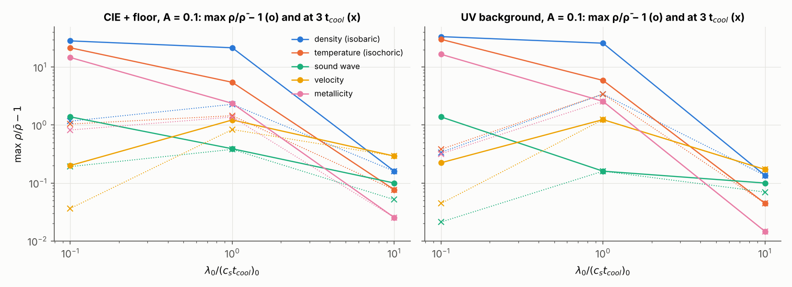

### 4.8 Do perturbations always grow?

During cooling, a density seed never fell below its initial amplitude in any
infinite-medium run, starting from 10⁵–10⁶ K. In linear theory it can only
shrink where Λ_T > 2, which on these curves happens only between about 2×10⁴
and 6×10⁴ K. Among 320 density-seed simulations, the only dips (to 0.5–0.86 of
the seed) are in five small clouds (L < c_s t_cool) with just 2.5 wavelengths
per cloud, where motions on the scale of the whole cloud project onto the mode. Temperature and metallicity seeds start with no density
perturbation, and at long wavelengths their density response stays small.

After the gas reaches the floor or T_eq:

* At short wavelengths (x ≲ 0.3) the perturbation becomes a sound wave in the
  cold gas and swings through zero. With the UV background, residual entropy
  is also erased because gas at T_eq is thermally stable; 10 of 91
  infinite-medium and 14 of 62 cloud runs with the UV background end below
  their initial amplitude (all after first growing more than 2×), compared with
  0 of 63 and 2 of 62 with the floor.
* Small clouds smooth out after collapsing.
* At x ≳ 1 the post-cooling growth continues steadily through the end of the
  runs.

## 5. Critique of the poster setup

1. **Whether the poster's clouds grow depends mostly on the density contrast
   χ.** At n_bg = 0.01–0.02 and T_bg ≈ 10⁶ K, c_s t_cool of the cloud gas is
   0.2–1.4 kpc for χ = 2 but ~2–6 kpc for χ ≈ 1.3. With λ ≈ 7–30 kpc that is
   x ≫ 1 for χ = 2 and x ~ 2–5 for χ ≈ 1.3. For χ = 1.3, Z = 0.1, n_bg = 0.01,
   L = 50 kpc we find ×1.8 while cooling and ×7 by 2.5 t_cool, the same order as
   the poster's Fig. 6, so her measured growth looks physical. Most of it comes
   after the gas has cooled. At χ = 2 the perturbations still grow, as
   G − 1 ≈ 25 (c_s t_cool/λ)² and rising (§4.4).
2. **The diagnostic.** Her central/interior maximum is the right idea. Two
   refinements help: measure in the mass coordinate, since the cloud shrinks;
   and project onto the seeded mode, which separates it from harmonics and from
   waves launched at the edges. `plutorun.Run.analyse` does both and also
   returns the interior maximum (`amp_max`).
3. **Comparing runs at a fixed simulation time.** t_cool differs by large
   factors between runs, so at a fixed time the runs are at different stages.
   Normalize time by a cooling time defined by when the gas actually cools
   (here: reaching 1.5 T_floor), not by when it reaches the floor exactly; the
   last approach to the floor is slow and its duration depends on the cooling
   table.
4. **Use dimensionless parameters**: λ/(c_s t_cool), L/(c_s t_cool), χ, Z
   (weakly) and A. With collisional cooling, density and size are exactly
   degenerate; with a UV background nearly so.
5. **Units and timescales.** The poster says 0.1 code units = 0.01 Gyr, but the
   profiles run to ~0.1 Gyr; with kpc and 100 km/s units, 1 code time unit is
   9.78 Myr. The runs also stop around 1–2 t_cool, before most of the
   post-cooling growth.
6. **"Pressure equilibrium" holds only at t = 0.** Once the cloud cools it is out
   of pressure balance with the hot gas; edge effects then reach the interior.
   The periodic "infinite cloud" removes the edges and is the cleanest place to
   measure growth.
7. **Background thermal model.** Masking cooling with a tracer works well, but
   the tracer diffuses at the edges. A temperature cut (no cooling above
   ~0.6 T_bg, as in Gronke & Oh) avoids that. Uniform heating equal to the
   background cooling, with cooling everywhere, made the shocked hot gas cool
   into thin radiative shells; those runs developed near-vacuum cells and
   stalled. I'd keep the mask.
8. **Resolution.** A cloud smaller than c_s t_cool is compressed 50–350×, so
   cells per wavelength must be counted after the collapse.
9. **Single sinusoid, single quantity.** Section 4.7 shows that the kind of
   perturbation matters as much as its amplitude. Real CGM fluctuations mix
   density, temperature, velocity and metallicity; a perturbation spectrum with
   random phases in several fields is the natural next step.
10. **Cooling function at low density.** A UV background is the better default
    for CGM densities (`COOL_MODE = 1`, `cooling="pie"`), even though it
    changes the linear results only modestly.
11. **1D limits.** Cold gas can only form slabs, and at a uniform floor
    temperature and pressure the slabs end at the same density. "Shattering"
    needs 2D/3D; the 1D survey tells you which (x, L/c_s t_cool, A, seed type)
    to run in 2D.

## 6. Suggested next steps for the student

1. Reproduce Fig. 2 with her own PLUTO install, to validate her code, cooling
   table and diagnostic. The PLUTO 4.4 port in `pluto_setup/pluto4.4_untested/`
   should be compiled and checked against the gPLUTO version first.
2. Swap in her own tables (`cooling.load_table`) and recompute the linear maps.
3. Make the central plot amplification vs λ/(c_s t_cool) for several
   L/(c_s t_cool), with linear theory and simulations together (Fig. 6), then
   the minimum-amplitude map (Fig. 4) and the seed-type comparison (Fig. 19).
4. Run longer (≳ 5 t_cool) to see where the post-cooling growth saturates, then
   follow the nonlinear outcome for x ≲ 1 and A ≳ 0.01 at higher resolution and
   in 2D.

## 7. What was not done or is uncertain

* The original CIE table is an approximation (0.1–0.3 dex off between 2×10⁵
  and 3×10⁶ K); the Cloudy runs do not have this problem and give the same
  trends.
* The UV-background runs use z = 0 only, keep the mean molecular weight of fully
  ionized gas (T is slightly misplaced near 10⁴ K), and ignore self-shielding.
* The PLUTO 4.4 files were not compiled.
* The heated-background comparison did not produce usable runs (§5, item 7).
* Late-time values for strongly compressed small clouds are resolution-limited
  (§4.5).

## 8. Corrections to earlier versions of this report

* **Time normalization.** Earlier versions used the time to reach 1.05 T_floor
  (or T_eq) as the end of cooling. With the corrected definition the "growth
  while cooling" is about 2× smaller at x ≲ 0.3, the prefactor of the
  isochoric scaling is 25 instead of 50, and the χ = 1.3 example gives ×1.8 and
  ×7 instead of ×3 and ×10.
* **UV background.** An earlier version said the UV background roughly halves
  the growth while cooling at x ≈ 0.3–3. That came from the slow last approach
  to the floor in the Cloudy CIE table inflating its end-of-cooling time. With
  consistent times the two agree to ~20%.
* **Run lengths.** Comparisons of late-time contrast between cooling models
  previously mixed runs of different length in t_cool; they are now compared
  over the same 3 t_cool.
* **Edge-dominated diagnostic.** An early version said the poster's measurement
  was dominated by the cloud edges; the student measures the interior, which
  is sound.
